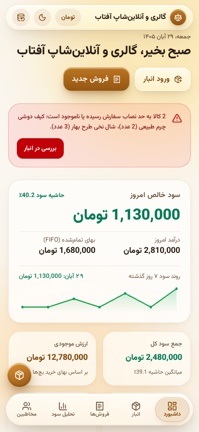
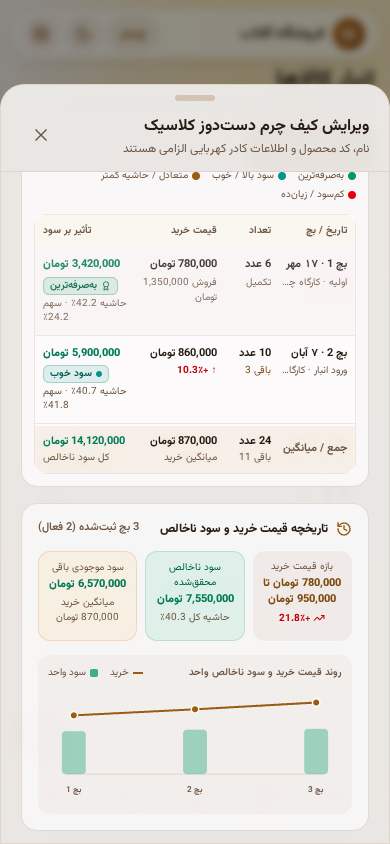

<div dir="rtl" align="right">

<p align="center">
  
</p>

<h1 align="center">میزان — دفتر زنده موجودی انبار و سود</h1>

<p align="center">
  اپلیکیشن تحت‌وب پیشرونده (PWA) و آماده انتشار اندروید برای مدیریت دقیق موجودی انبار، محاسبه خودکار بهای تمام‌شده به روش <strong>FIFO</strong>، ثبت فروش‌های حضوری و آنلاین و تحلیل لحظه‌ای سود واقعی — تماماً فارسی، راست‌به‌چپ و ساخته‌شده با تمرکز بر تجربه موبایل.
</p>

<p align="center">
  
  
  
  
  
  
</p>

---

## پیش‌نمایش رابط کاربری

### نسخه موبایل (حالت روز، حالت شب و جدول تاریخچه خرید بچ‌ها)

<p align="center">
  
  &nbsp;&nbsp;
  
  &nbsp;&nbsp;
  
</p>

### نسخه دسکتاپ (واکنش‌گرا با ستون شناور سمت راست)

<p align="center">
  
</p>

---

## امکانات کلیدی

- **طراحی شناور الهام‌گرفته از iOS و تلگرام**: نوار بالا و منوی پایین موبایل به‌صورت جزیره شیشه‌ای شناور با افکت `backdrop-blur`، حاشیه درخشان ملایم و حالت روز و شب کامل با قلم **وزیرمتن (Vazirmatn)**.
- **محاسبه دقیق سود و بهای تمام‌شده (FIFO)**: هنگام ثبت هر فروش، کالا به‌صورت خودکار از قدیمی‌ترین بچ خرید کسر می‌شود و سود خالص و حاشیه سود واقعی بدون خطا محاسبه می‌گردد.
- **پشتیبانی از خرید و فروش چندنرخی برای یک کالا**: می‌توانید یک کالا را در تاریخ‌های مختلف با قیمت خرید و فروش متفاوت وارد انبار کنید، سهم هر بچ در سود را ببینید و هنگام فروش بین حالت خودکار FIFO یا انتخاب یک بچ مشخص تصمیم بگیرید.
- **تاریخچه قیمت خرید و نشانگرهای سودآوری بچ‌ها**: در فرم ویرایش هر کالا، جدول تاریخچه خریدهای قبلی (`PurchaseHistoryTable`) همراه با نشانگرهای رنگی سودآوری (*به‌صرفه‌ترین*، *سود خوب*، *حاشیه کمتر*، *کم‌سود / زیان‌ده*) و اسکرول عمودی بهینه برای موبایل نمایش داده می‌شود.
- **ساخته‌شده برای فروش آنلاین و حضوری**: پشتیبانی کامل از کانال‌های فروش **آنلاین**، **اینستاگرام**، **تلگرام / واتساپ**، **سایت / باسلام**، **حضوری** و **عمده**؛ همراه با ثبت سریع نام مشتری، آیدی یا کد سفارش (مثل `سفارش #1048`) و قابلیت ابطال فروش با بازگشت خودکار موجودی به بچ‌های اصلی.
- **نمایش شفاف مبالغ به تومان و ریال**: نمایش دقیق و خوانای ارقام به **تومان** (یا **ریال** با یک لمس) بدون اختصارهای گیج‌کننده.
- **آفلاین کامل + پشتیبان‌گیری و بازیابی (Backup / Restore)**: تمام اطلاعات بدون نیاز به ساخت حساب کاربری یا سرور خارجی روی دستگاه شما ذخیره می‌شود و هر زمان می‌توانید نسخه پشتیبان JSON دانلود یا بازیابی کنید.

---

## نصب و اجرای محلی (توسعه)

پیش‌نیاز: **Node.js نسخه ۲۰ به بالا**

```bash
# ۱. کلون کردن مخزن
git clone https://github.com/<your-username>/mizan-ledger.git
cd mizan-ledger

# ۲. نصب وابستگی‌ها
npm install

# ۳. اجرای محیط توسعه (روی پورت 3000)
npm run dev
```

### دستورهای کاربردی

| دستور | توضیح |
| :--- | :--- |
| `npm run dev` | اجرای سرور توسعه روی `http://localhost:3000` |
| `npm run build` | ساخت خروجی نهایی بهینه همراه با Service Worker و Manifest (در پوشه `dist/`) |
| `npm run lint` | بررسی کامل تایپ‌های TypeScript (`tsc --noEmit`) |
| `npm test` | اجرای تست‌های واحد منطق FIFO، چندنرخی، تاریخچه خرید و پشتیبان‌گیری |

---

## نصب روی گوشی اندروید و ساخت فایل APK امضاشده (بدون خطای Unsafe)

اپلیکیشن میزان به دو روش کاملاً امن روی گوشی اندروید قابل نصب است:

### روش ۱: نصب مستقیم PWA (سریع‌ترین روش — بدون هیچ هشدار امنیتی)
نسخه وب میزان دارای **Web App Manifest**، آیکون‌های استاندارد (`192px`، `512px` و `Maskable`) و **Service Worker آفلاین** است. پس از میزبانی پوشه `dist/` روی هر هاست HTTPS (مانند GitHub Pages، Cloudflare Pages یا Vercel):
1. آدرس اپ را در مرورگر Chrome اندروید (یا Safari آیفون) باز کنید.
2. دکمه **«نصب اپلیکیشن»** داخل برنامه (یا گزینه *Add to Home Screen*) را بزنید.
3. اپ با آیکون اختصاصی، تمام‌صفحه (`standalone`) و کاملاً آفلاین بدون هیچ هشدار Play Protect نصب می‌شود.

### روش ۲: بیلد استاندارد محلی یا خودکار (APK و AAB امضاشده با امن‌سازی تولیدی)
در این مخزن، اسکریپت‌های استاندارد تولید نسخه اندروید (`scripts/build-android.sh`، `scripts/generate-keystore.sh`، `scripts/harden-android.mjs`) به همراه تنظیمات امنیتی `android-config/` و ورک‌فلو **GitHub Actions** قرار داده شده‌اند تا فایل‌های **APK** و **AAB** با امضای **v1/v2/v3/v4** و بدون خطاهای امنیتی **Unsafe / Play Protect** تولید شوند.

#### تنظیمات امنیتی اعمال‌شده برای رفع خطاهای Unsafe در محیط تولید
- **مسدودسازی کامل ترافیک ناامن HTTP (`cleartextTrafficPermitted="false"`):** از طریق فایل `android-config/network_security_config.xml` و `usesCleartextTraffic="false"` در `AndroidManifest.xml` و فقط اعتماد به گواهی‌های سیستمی (`system` CAs).
- **غیرفعال‌سازی دیباگ و استخراج داده در نسخه انتشار:** تنظیم خودکار `debuggable="false"`، `webContentsDebuggingEnabled: false` در WebView و `allowBackup="false"` برای جلوگیری از استخراج داده از طریق ADB.
- **فشرده‌سازی و حذف لاگ‌های دیباگ با R8/ProGuard:** فعال‌سازی `minifyEnabled` و `shrinkResources` همراه با قواعد اختصاصی `android-config/proguard-rules.pro`.
- **اجبار امضای دائمی تولیدی (v1/v2/v3/v4):** اسکریپت بیلد از ساخت تصادفی نسخه تولیدی با کلید دیباگ جلوگیری می‌کند، امضای نهایی را با `apksigner verify` و `jarsigner -verify -strict` تأیید کرده و فایل `SHA256SUMS.txt` تولید می‌کند.

#### گام ۱ — ساخت کلید امضای اختصاصی (Keystore) با یک دستور
> **نکته بسیار مهم:** فایل `mizan-release.jks` و `keystore.properties` به‌صورت خودکار در `.gitignore` مسدود شده‌اند؛ کلید خود را در یک مدیریت رمز امن نگهداری کنید و هرگز در گیت‌هاب کامیت نکنید.

```bash
npm run android:keystore
```

#### گام ۲ — ساخت محلی فایل نصبی امضاشده (APK و AAB)
در صورت نصب بودن **JDK 21** و **Android SDK** (`ANDROID_SDK_ROOT` یا `ANDROID_HOME`):

```bash
# ساخت هم‌زمان APK و AAB امضاشده در پوشه release-artifacts/
npm run android:build

# یا ساخت جداگانه:
npm run android:build:apk
npm run android:build:aab
```

#### گام ۳ — ساخت خودکار در GitHub Actions (بدون نیاز به نصب Android SDK)
در مخزن گیت‌هاب به مسیر `Settings → Secrets and variables → Actions → New repository secret` بروید و ۴ مقدار زیر را وارد کنید:

| نام Secret | مقدار |
| :--- | :--- |
| `ANDROID_KEYSTORE_BASE64` | خروجی `base64 -w 0 mizan-release.jks` |
| `ANDROID_KEYSTORE_PASSWORD` | رمز عبور Keystore |
| `ANDROID_KEY_ALIAS` | نام مستعار کلید (مثلاً `mizan-release`) |
| `ANDROID_KEY_PASSWORD` | رمز عبور کلید |

سپس با انتشار تگ نسخه (`git tag v1.0.0 && git push origin v1.0.0`) یا اجرای دستی ورک‌فلو **Android Signed Release Build** در تب Actions، فایل‌های `mizan-release-signed.apk`، `mizan-release-signed.aab` و `SHA256SUMS.txt` به‌صورت خودکار تولید و ضمیمه می‌شوند.

> **توصیه برای انتشار عمومی بدون هیچ هشدار در تمام گوشی‌های اندروید:** خروجی `mizan-release-signed.aab` را در **کافه‌بازار / مایکت** یا **Google Play Console** (با Play App Signing) منتشر کنید؛ یا از نسخه **PWA / TWA** روی دامنه HTTPS استفاده کنید.

---

## ساختار پروژه

```text
├── .github/workflows/
│   ├── ci.yml                     # بررسی خودکار تایپ‌ها، تست‌ها و بیلد وب
│   └── android-release.yml        # ساخت خودکار APK و AAB امضاشده اندروید
├── docs/screenshots/              # اسکرین‌شات‌های مستندات
├── public/                        # آیکون‌های SVG و PNG استاندارد PWA / iOS / Android
├── src/
│   ├── components/
│   │   ├── LayoutShell.tsx        # نوارهای شناور iOS/تلگرام و سایدبار دسکتاپ
│   │   ├── PWAInstallButton.tsx   # دکمه نصب درون‌برنامه‌ای و نشانگر حالت آفلاین
│   │   ├── PurchaseHistoryTable.tsx # جدول تاریخچه خریدها با نشانگر سودآوری بچ‌ها
│   │   ├── PurchasePriceHistoryPanel.tsx
│   │   ├── WelcomeScreen.tsx
│   │   └── modals/                # فرم کالا، ثبت فروش آنلاین/حضوری، ورود انبار، بکاپ
│   ├── context/LedgerContext.tsx  # مدیریت وضعیت دفتر، ذخیره محلی و پشتیبان‌گیری
│   ├── hooks/usePWAInstall.ts     # هوک‌های نصب PWA و وضعیت شبکه
│   ├── types/mizan.ts             # تایپ‌ها و کانال‌های فروش آنلاین و حضوری
│   ├── utils/
│   │   ├── fifo.ts                # موتور محاسبه FIFO، چندنرخی و تاریخچه خرید
│   │   ├── analytics.ts           # تجمیع داشبورد و گزارش‌های سود
│   │   ├── backup.ts              # اعتبارسنجی و تبدیل فایل پشتیبان JSON
│   │   ├── formatters.ts          # قالب‌بندی تومان/ریال و تاریخ شمسی
│   │   └── mizan.test.ts          # مجموعه تست‌های واحد (node:test)
│   └── views/                     # صفحات داشبورد، انبار، فروش‌ها، تحلیل سود و مخاطبین
├── capacitor.config.ts            # تنظیمات بسته‌بندی اندروید (Capacitor)
├── vite.config.ts                 # تنظیمات Vite و VitePWA
└── LICENSE                        # مجوز MIT
```

---

## مجوز انتشار

این پروژه تحت مجوز **MIT** منتشر شده است. جزئیات بیشتر را در فایل [LICENSE](LICENSE) بخوانید.

</div>
