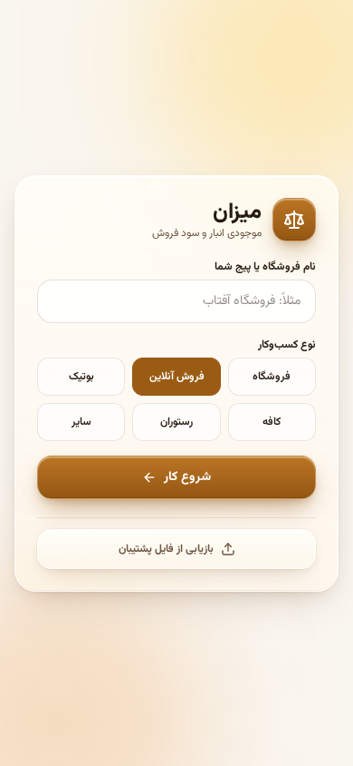
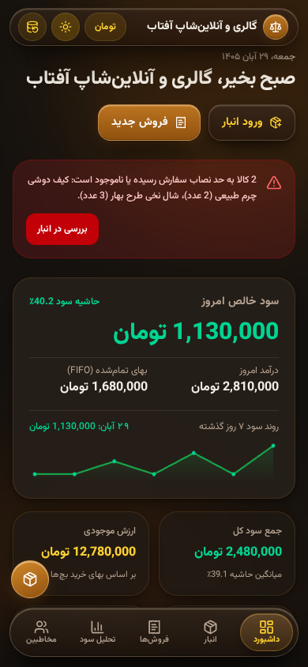
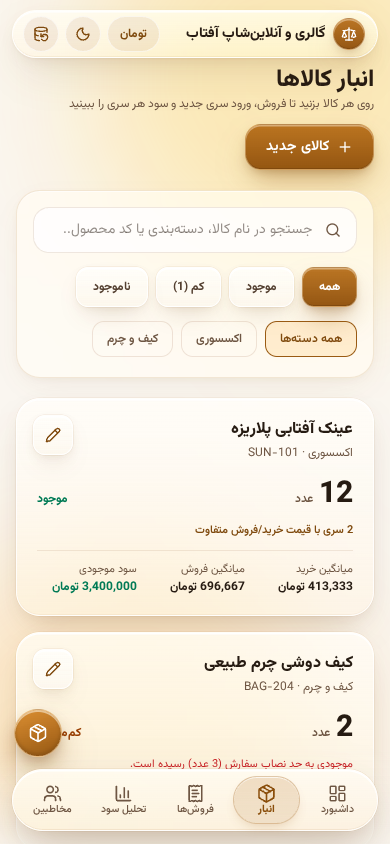
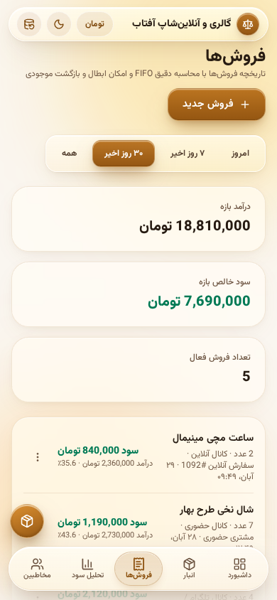
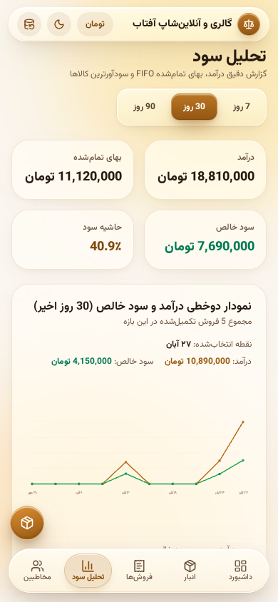
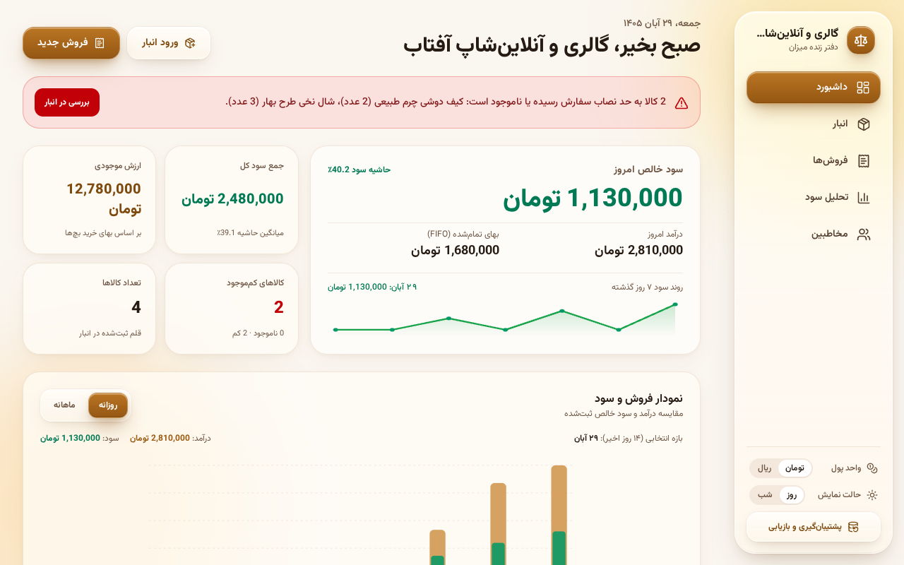

<div dir="rtl" align="right">

<p align="center">
  
</p>

<h1 align="center">میزان — دفتر زنده موجودی انبار و سود</h1>

<p align="center">
  اپلیکیشن موبایل‌محور (<strong>PWA</strong> و آماده بیلد بومی <strong>Android APK / AAB</strong>) برای مدیریت لحظه‌ای موجودی انبار، محاسبه خودکار بهای تمام‌شده به روش <strong>FIFO</strong>، ثبت فروش‌های آنلاین و حضوری و تحلیل دقیق سود واقعی — تماماً فارسی، راست‌به‌چپ و کاملاً آفلاین.
</p>

<p align="center">
  
  
  
  
  
  
</p>

<p align="center">
  <a href="#تصاویر-برنامه">تصاویر برنامه</a> •
  <a href="#امکانات-کلیدی">امکانات کلیدی</a> •
  <a href="#نصب-و-اجرای-محلی">نصب و اجرا</a> •
  <a href="#بیلد-اندروید-apk--aab-و-تنظیمات-امنیتی">بیلد اندروید (APK/AAB)</a> •
  <a href="#ساختار-پروژه">ساختار پروژه</a>
</p>

---

## تصاویر برنامه

### نمای موبایل — شروع سریع، داشبورد (حالت روز و شب)

<p align="center">
  
  &nbsp;&nbsp;
  
  &nbsp;&nbsp;
  
</p>

### انبار شناور، تاریخچه قیمت خرید بچ‌ها، فروش‌ها و تحلیل سود

<p align="center">
  
  &nbsp;
  
  &nbsp;
  
  &nbsp;
  
</p>

### نمای دسکتاپ واکنش‌گرا

<p align="center">
  
</p>

---

## امکانات کلیدی

- **رابط کاربری شیشه‌ای شناور (iOS / Telegram Liquid Glass):** نوار بالا، منوی پایین موبایل، کنترل‌های بخش‌بندی‌شده و کارت‌های کالا با افکت شیشه‌ای عمیق (`backdrop-filter`)، سایه‌های شناور چندلایه، واکنش فشردن لمسی (haptic-like) و حالت روز و شب کامل همراه با قلم **وزیرمتن (Vazirmatn)**.
- **موتور حسابداری انبار FIFO و خرید چندنرخی:** امکان ثبت یک کالا با قیمت‌های خرید و فروش متفاوت در بچ‌های مختلف؛ هنگام فروش، موجودی به‌طور خودکار از قدیمی‌ترین بچ کسر می‌شود و بهای تمام‌شده و سود واقعی بدون خطا محاسبه می‌گردد.
- **تاریخچه قیمت خرید و نشانگرهای سودآوری بچ‌ها:** نمایش فهرست خریدهای قبلی هر کالا (`PurchaseHistoryTable`) همراه با درصد تغییر قیمت، سهم سود هر بچ و نشانگرهای رنگی (*به‌صرفه‌ترین*، *سود خوب*، *حاشیه کمتر*، *کم‌سود / زیان‌ده*).
- **آماده برای فروش آنلاین و حضوری:** پشتیبانی از کانال‌های **آنلاین**، **اینستاگرام**، **تلگرام / واتساپ**، **سایت / باسلام**، **حضوری** و **عمده** با ثبت سریع آیدی یا شماره سفارش، کنترل موجودی، و قابلیت ابطال فروش با بازگشت خودکار موجودی به بچ‌های اصلی.
- **تحلیل سود و گزارش‌گیری شمسی:** داشبورد زنده با تاریخ شمسی، روند سود ۷ روزه، نمودار روزانه و ماهانه، تحلیل بازه‌های ۷ / ۳۰ / ۹۰ روزه و رتبه‌بندی سودآورترین کالاها.
- **شفافیت کامل در واحد پول:** نمایش مستقیم مبالغ به **تومان** یا **ریال** (قابل جابه‌جایی با یک لمس) بدون اختصارهای مبهم.
- **حریم خصوصی و عملکرد ۱۰۰٪ آفلاین:** بدون نیاز به ساخت حساب کاربری یا سرور خارجی؛ ذخیره محلی امن روی دستگاه به همراه خروجی و بازیابی کامل فایل پشتیبان (**Backup / Restore JSON**).

---

## نصب و اجرای محلی

پیش‌نیاز: **Node.js نسخه ۲۰ به بالا**

```bash
# ۱. کلون کردن مخزن
git clone https://github.com/<your-username>/mizan-ledger.git
cd mizan-ledger

# ۲. نصب وابستگی‌ها
npm install

# ۳. اجرای محیط توسعه روی پورت 3000
npm run dev
```

### دستورهای کاربردی

| دستور | کاربرد |
| :--- | :--- |
| `npm run dev` | اجرای سرور توسعه روی `http://localhost:3000` |
| `npm run build` | ساخت خروجی تولیدی وب همراه با Service Worker و Manifest در پوشه `dist/` |
| `npm run lint` | بررسی کامل تایپ‌های TypeScript (`tsc --noEmit`) |
| `npm test` | اجرای تست‌های واحد موتور FIFO، چندنرخی، تاریخچه خرید و پشتیبان‌گیری |
| `npm run android:keystore` | ساخت کلید امضای دائمی تولیدی (RSA 4096-bit) و `keystore.properties` محلی |
| `npm run android:build` | ساخت هم‌زمان فایل‌های امضاشده **APK** و **AAB** در پوشه `release-artifacts/` |
| `npm run android:build:apk` | ساخت فایل نصبی امضاشده **APK** |
| `npm run android:build:aab` | ساخت بسته انتشار امضاشده **AAB** برای Google Play، کافه‌بازار و مایکت |

---

## بیلد اندروید (APK / AAB) و تنظیمات امنیتی

میزان به دو روش کاملاً امن و استاندارد روی گوشی‌های اندروید قابل نصب است:

### روش ۱: نصب مستقیم به‌عنوان PWA (بدون نیاز به APK)
پس از میزبانی پوشه `dist/` روی هر سرویس HTTPS (مانند GitHub Pages، Cloudflare Pages یا Vercel)، کافی است آدرس را در مرورگر Chrome اندروید یا Safari آیفون باز کرده و دکمه **«نصب اپلیکیشن»** را بزنید تا به‌صورت تمام‌صفحه و آفلاین نصب شود.

### روش ۲: بیلد بومی امضاشده اندروید (APK و AAB بدون خطای Unsafe)
اسکریپت‌های استاندارد `scripts/build-android.sh`، `scripts/generate-keystore.sh` و `scripts/harden-android.mjs` همراه با فایل‌های امنیتی `android-config/` تمام پیش‌نیازهای امنیتی نسخه تولیدی را به‌صورت خودکار اعمال می‌کنند:

- **مسدودسازی ترافیک ناامن HTTP:** تنظیم `cleartextTrafficPermitted="false"` در `network_security_config.xml` و `usesCleartextTraffic="false"` در `AndroidManifest.xml` با اعتماد انحصاری به گواهی‌های سیستمی (`system` CAs).
- **غیرفعال‌سازی دیباگ و استخراج داده:** اعمال خودکار `debuggable="false"`، غیرفعال‌سازی دیباگ WebView (`webContentsDebuggingEnabled: false`) و مسدود کردن استخراج داده از طریق ADB (`allowBackup="false"`).
- **بهینه‌سازی و پاک‌سازی لاگ با R8 / ProGuard:** فعال‌سازی `minifyEnabled`، `shrinkResources` و حذف لاگ‌های دیباگ در بیلد نهایی.
- **امضای دائمی v1/v2/v3/v4 و تأیید صحت:** جلوگیری از ساخت تصادفی بیلد تولیدی با کلید دیباگ، بررسی امضا با `apksigner verify` و `jarsigner -verify -strict` و تولید `SHA256SUMS.txt`.

#### گام‌های بیلد محلی یا خودکار با GitHub Actions
1. یک بار کلید امضای اختصاصی خود را بسازید (فایل کلید و `keystore.properties` در `.gitignore` محافظت می‌شوند و هرگز کامیت نخواهند شد):
   ```bash
   npm run android:keystore
   ```
2. برای بیلد روی سیستم خودتان (با نصب بودن JDK 21 و Android SDK):
   ```bash
   npm run android:build
   ```
3. برای بیلد خودکار در **GitHub Actions**، این ۴ Secret را در مسیر `Settings → Secrets and variables → Actions` مخزن ثبت کنید:
   - `ANDROID_KEYSTORE_BASE64` (خروجی `base64 -w 0 mizan-release.jks`)
   - `ANDROID_KEYSTORE_PASSWORD`
   - `ANDROID_KEY_ALIAS`
   - `ANDROID_KEY_PASSWORD`
   سپس یک تگ نسخه منتشر کنید (`git tag v1.0.0 && git push origin v1.0.0`) یا ورک‌فلو **Android Signed Release Build** را از تب Actions اجرا کنید تا فایل‌های `mizan-release-signed.apk`، `mizan-release-signed.aab` و `SHA256SUMS.txt` به‌صورت خودکار آماده شوند.

---

## ساختار پروژه

```text
├── .github/workflows/
│   ├── ci.yml                           # بررسی خودکار تایپ‌ها، تست‌ها و بیلد وب
│   └── android-release.yml              # بیلد و امضای خودکار APK و AAB در گیت‌هاب
├── android-config/
│   ├── network_security_config.xml      # مسدودسازی HTTP و محدودیت به گواهی‌های سیستمی
│   ├── proguard-rules.pro               # قواعد R8/ProGuard و حذف لاگ‌های دیباگ
│   ├── release-signing.gradle           # تنظیمات امضای v1/v2/v3/v4 و فشرده‌سازی بیلد
│   └── keystore.properties.example      # الگوی تنظیمات محلی کلید امضا
├── scripts/
│   ├── generate-keystore.sh             # ساخت کلید امضای 4096-bit PKCS12
│   ├── harden-android.mjs               # تزریق خودکار تنظیمات امنیتی به پروژه اندروید
│   ├── harden-android.test.mjs          # تست‌های واحد امن‌سازی مانیفست و Gradle
│   └── build-android.sh                 # اسکریپت استاندارد بیلد و تأیید APK/AAB
├── docs/screenshots/                    # اسکرین‌شات‌های مستندات (موبایل و دسکتاپ)
├── public/                              # آیکون‌های استاندارد PWA / iOS / Android
├── src/
│   ├── components/
│   │   ├── LayoutShell.tsx              # نوارهای شناور iOS/تلگرام و سایدبار دسکتاپ
│   │   ├── PWAInstallButton.tsx         # دکمه نصب درون‌برنامه‌ای و نشانگر حالت آفلاین
│   │   ├── PurchaseHistoryTable.tsx     # جدول تاریخچه خریدها با نشانگر سودآوری بچ‌ها
│   │   ├── PurchasePriceHistoryPanel.tsx
│   │   ├── WelcomeScreen.tsx            # صفحه شروع سریع و بازیابی پشتیبان
│   │   └── modals/                      # فرم کالا، ثبت فروش، ورود انبار، پشتیبان‌گیری
│   ├── context/LedgerContext.tsx        # مدیریت دفتر، ذخیره محلی و پشتیبان‌گیری
│   ├── hooks/usePWAInstall.ts           # هوک‌های نصب PWA و وضعیت شبکه
│   ├── types/mizan.ts                   # تایپ‌های مدل داده و کانال‌های فروش
│   ├── utils/
│   │   ├── fifo.ts                      # موتور محاسبه FIFO، چندنرخی و تاریخچه خرید
│   │   ├── analytics.ts                 # تجمیع داشبورد و گزارش‌های سود
│   │   ├── backup.ts                    # اعتبارسنجی و تبدیل فایل پشتیبان JSON
│   │   ├── formatters.ts                # قالب‌بندی تومان/ریال و تاریخ شمسی
│   │   └── mizan.test.ts                # مجموعه تست‌های واحد (node:test)
│   └── views/                           # داشبورد، انبار، فروش‌ها، تحلیل سود و مخاطبین
├── capacitor.config.ts                  # تنظیمات امن‌شده Capacitor اندروید
├── vite.config.ts                       # تنظیمات Vite و VitePWA
└── LICENSE                              # مجوز MIT
```

---

## مشارکت و مجوز انتشار

پیشنهادها و Pull Requestها با استقبال بررسی می‌شوند. این پروژه تحت مجوز **MIT** منتشر شده است — برای جزئیات فایل [LICENSE](LICENSE) را مطالعه کنید.

</div>
